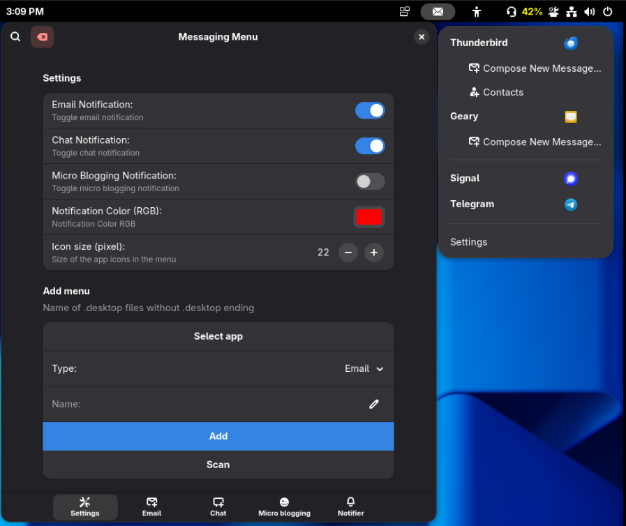

# Messaging Menu

<div align="center">

  

</div>

A Messaging Menu for the Gnome Shell. All email, chat, and microblogging
applications in one place.



This extension provides a convenience list of all installed email, chat and
microblogging applications with short cut actions like "Compose New Message",
"Contacts", "Calendar", "Tasks" and "Attachments" for email applications that
provide them. The icon lights up when you receive notifications from the listed
applications, so you won't miss another message.

The extension's preferences allow you to configure which types of applications
(email / chat / microblogging) you would like to receive notifications for and
which colour the icon should change to, to indicate notification. The icon can
also wiggle when a notification arrives. Middle-click the panel icon to open the
preferences.

Read [here](http://screenfreeze.net/messaging-menu-for-gnome-3/) for why this
extension was created.

Originally forked from https://github.com/screenfreeze/messagingmenu

## Installation

### The easy way (recommended):

[](https://extensions.gnome.org/extension/2896/messaging-menu)

### Download latest release

1. Download the zip file from the [release page](https://github.com/ChrisLauinger77/gnome-shell-extension-messagingmenu/releases/latest)
2. Install it with `gnome-extensions install --force messagingmenu@lauinger-clan.de.shell-extension.zip`
3. Restart GNOME Shell (log out and in on Wayland), then enable it with `gnome-extensions enable messagingmenu@lauinger-clan.de`

### Install from source

Use the `main` branch.

```bash
git clone https://github.com/ChrisLauinger77/gnome-shell-extension-messagingmenu.git
cd gnome-shell-extension-messagingmenu
./messagingmenu.sh install
```

Now restart GNOME Shell (log out and in on Wayland).

## Contributing

Pull requests are welcome.

To update the translation files run `./messagingmenu.sh translate` in the extensions directory after your code changes are finished. This will update the files in po folder. Then [Poedit](https://poedit.net/download) can be used to translate the strings. poedit can also be used to create new localization files.

# ✨️ Contributors

[](https://github.com/ChrisLauinger77/gnome-shell-extension-messagingmenu/graphs/contributors)
